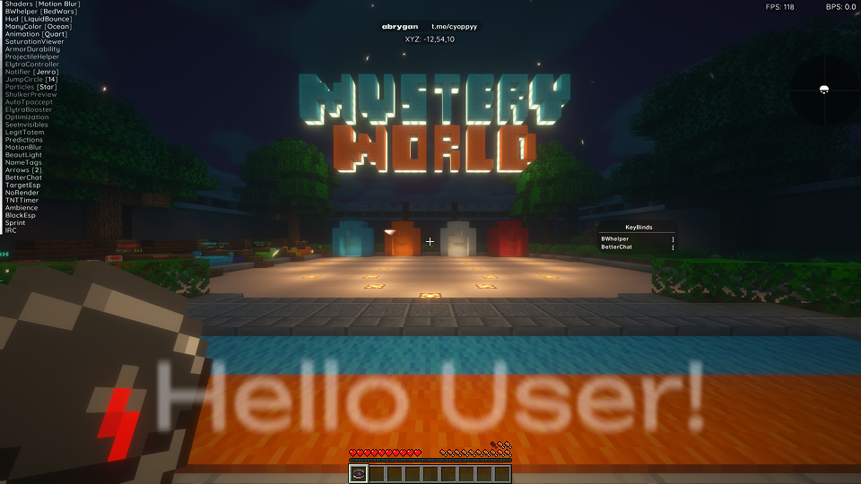

# AbryganClient (Minecraft Client: 1.16.5)

## 🇷🇺 (Русская версия)

**AbryganDlc** — клиент для Minecraft, созданный под стабильную работу на серверах с античитами **Grim** и **Matrix**.

Клиент изначально проектировался под сервера **Jenro**, **MineLand** и **MineBlaze** — с учётом их античитов, режимов и типичных настроек. При этом он подходит и для других проектов с похожими условиями.

### Главное о клиенте
- **Рейдж\Семи-Рейдж** - клиент больше создан для сильной и не аккуратной игры но предназначеный для быстрых побед.
- **250+ функций** — движение, бой, игрок, мир, визуал и утилиты.
- **Создан под Grim и Matrix** — поведение модулей подобрано так, чтобы снижать шум и сохранять стабильность на этих античитах.
- **Сделан под Jenro, MineLand и MineBlaze** — учитываются античиты, задержки и особенности режимов этих проектов.
- **Модульная архитектура** — каждый модуль настраивается отдельно, есть готовые профили под разные сервера.

### Под какие античиты

**Grim**  
Клиент учитывает проверки Grim: корректные повороты с привязкой к sensitivity, согласованный ввод и движение, аккуратная постановка блоков с задержками и корректной точкой клика. Всё это снижает количество ложных срабатываний и делает поведение предсказуемым для античита.

**Matrix**  
Клиент учитывает особенности Matrix: раздельный контроль скорости на земле, в воздухе и при спринте, аккуратная работа с краем блоков, режимы спринта и пересчёта ввода под поворот. Это позволяет сохранять стабильность движения и постановки блоков.

> Клиент не «обходит» античиты магией — он снижает шум: корректные повороты, задержки, согласованный ввод и предсказуемая постановка блоков.

### Под какие сервера

**Jenro**  
Настройки под типичные режимы PvP и движения на Jenro, с учётом активного Grim/Matrix.

**MineLand**  
Учтены задержки, лаг-компенсация и особенности режимов MineLand — как в движении, так и в бою.

**MineBlaze**  
Адаптация под античиты и режимы MineBlaze, корректная работа движения и постановки блоков при активном Grim/Matrix.

> Для других серверов клиент тоже работает — просто на Jenro, MineLand и MineBlaze он настроен «из коробки».

### Возможности (кратко)

Клиент содержит **250+ функций**. Основные категории:

| Категория                       |     
|---------------------------------|     
| **Movement**                    |     
| **Combat**                      |     
| **Player**                      |     
| **Render**                      |     
| **Misc**                        |

### FAQ

* Telegram Канал: https://t.me/AbryganClient
* Telegram Логи Овнера: https://t.me/AB_DevLog
* Youtube: https://www.youtube.com/@by_rok1k

### Дисклеймер

Клиент предоставляется исключительно в ознакомительных целях. Автор не несёт ответственности за блокировки аккаунтов, нарушение правил серверов и любой другой ущерб. Используй на свой страх и риск и соблюдай правила проектов, на которых играешь.

---

## 🇬🇧 (English Version)

**AbryganDlc** is a Minecraft client built for stable performance on servers protected by **Grim** and **Matrix** anticheats.

The client was originally designed for **Jenro**, **MineLand** and **MineBlaze** — taking into account their anticheats, gamemodes and typical settings. It also works on other projects with similar conditions.

### Key facts
- **Rage/Semi-Rage** – a client designed primarily for aggressive, less cautious gameplay, aimed at securing quick victories.
- **250+ features** — movement, combat, player, world, visual and utility modules.
- **Built for Grim and Matrix** — module behavior is tuned to reduce noise and stay stable on these anticheats.
- **Made for Jenro, MineLand and MineBlaze** — anticheats, delays and gamemode specifics of these projects are taken into account.
- **Modular architecture** — every module is configurable, with ready-made profiles for different servers.

### Supported anticheats

**Grim**  
The client accounts for Grim checks: correct rotations tied to sensitivity, consistent input and movement, careful block placement with delays and correct hit vectors. This reduces false positives and makes behavior predictable for the anticheat.

**Matrix**  
The client accounts for Matrix specifics: separate speed control on ground, in air and while sprinting, careful edge handling, sprint and input-remap modes. This keeps movement and block placement stable.

> The client doesn't "bypass" anticheats with magic — it reduces noise: correct rotations, delays, consistent input and predictable block placement.

### Supported servers

**Jenro**  
Tuned for typical PvP and movement gamemodes on Jenro, with active Grim/Matrix in mind.

**MineLand**  
Accounts for delays, lag compensation and gamemode specifics of MineLand — in both movement and combat.

**MineBlaze**  
Adapted to MineBlaze anticheats and gamemodes, with stable movement and block placement under active Grim/Matrix.

> The client also works on other servers — it's simply tuned out of the box for Jenro, MineLand and MineBlaze.

### Features (short overview)

The client ships with **250+ features**. Main categories:

| Category     |     
|--------------|     
| **Movement** |     
| **Combat**   |     
| **Player**   |     
| **Render**   |     
| **Misc**     |

### FAQ

* Telegram Channel: https://t.me/AbryganClient
* Telegram DevLogs: https://t.me/AB_DevLog
* Youtube: https://www.youtube.com/@by_rok1k

### Disclaimer

The client is provided for educational purposes only. The author is not responsible for account bans, server rule violations or any other damage. Use at your own risk and follow the rules of the projects you play on.

                                      :---:                                      
                                    .------:.                                    
                                  .:------.                                      
                                 .::----:  :---:.                                
                               .:::::::. .:------:.                              
                              :----::.  .:::------:.                             
                            .:-----:. .::::---------:.                           
                          .::----:.  :-----:. .:---:::.                          
                         .-------:::------:  .::::::..:.                         
                       .:::--------------.  :----::::::::.                       
                     .::----:::------:.   :------:..:::---:.                     
                    .:---------::.      .:------:   .::::--:.                    
                    .----------:::--::    .:----::.  .:------:.                  
                    ... :--=-----::::::.   .:-:::::.   .:-----:.                 
                   .:----------:::::::--:.  .:------:.  .:::::::.                
              .:---=====----:.   ...::--:.    .:-------:::--------.              
             ..--===---:..          ....       .:-----------------..             
                .....                            .................               

